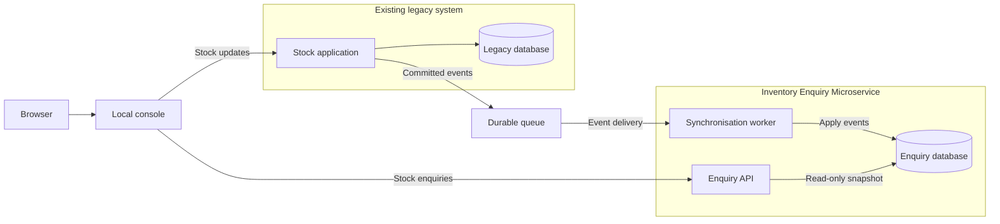

# ABC Pharmaceuticals — Microservices Demonstrator

A local prototype that demonstrates extracting an inventory-enquiry microservice from an existing stock-management application.

The dashboard makes service boundaries, data ownership, event delivery and failure recovery visible. Backend components run as separate processes and communicate over HTTP. All medicine and inventory data is fictional; no patient data is used.

## Requirements

- [uv](https://docs.astral.sh/uv/getting-started/installation/) for Python environment and dependency management.
- Python 3.12 or newer. The included `.python-version` selects Python 3.12; `uv` can download it if needed.
- A modern web browser.

No Docker, database server, cloud account, external API key or frontend build is required. Initial setup needs internet access; the dashboard runs locally without external services.

## Quick start

After downloading or cloning the project, open a terminal in its parent directory:

```bash
cd abc-pharmaceuticals-micro
uv sync
uv run python run.py
```

Open **http://127.0.0.1:8100**.

`uv sync` creates `.venv/` and installs the locked application dependencies. No manual environment activation is needed.

On first startup, the application creates `.runtime/`, its SQLite databases and the initial fictional inventory automatically. Allow a few seconds for the first synchronisation checkpoint; the dashboard should then show four responding backend processes and verified enquiry data.

Keep the terminal open while using the dashboard. Press **Ctrl+C** in that terminal to stop the console and all four backend processes. The dashboard's Stop buttons control individual components only.

To start again:

```bash
uv run python run.py
```

The same commands work in PowerShell. If using WSL, run them in the WSL terminal and open the address in your browser.

## Architecture

The **Inventory Enquiry Microservice** is one business capability, comprising its API, synchronisation worker and separately owned read model. The legacy stock application remains authoritative. The queue is infrastructure, not another business microservice.



The console hosts the interface, forwards requests over HTTP and controls the four named backend processes. It never reads business databases. The enquiry service never reads the legacy database.

| Process | Default port | Responsibility |
|---|---|---|
| Console | 8100 | Interface, HTTP observation and process controls |
| Legacy stock application | 8101 | Stock writes, versions and transactional outbox |
| Durable queue | 8102 | Persist deliveries, lease, acknowledge and retry |
| Synchronisation worker | 8103 | Apply validated events to the enquiry-owned database |
| Enquiry API | 8104 | Read-only, completeness-checked and freshness-checked enquiries |

The local queue is an educational SQLite-backed HTTP implementation with one ordered stream and one consumer, not a production message broker. Separate processes demonstrate runtime independence; they are not separate operating-system security boundaries.

## API documentation

FastAPI automatically provides interactive **Swagger UI** documentation for each runtime component. These pages describe its HTTP endpoints, request fields and response schemas. They are documentation interfaces, **not additional microservices**.

Start the application before opening these default addresses:

| Runtime component | Interactive documentation | Main HTTP interfaces |
|---|---|---|
| Local console | [127.0.0.1:8100/docs](http://127.0.0.1:8100/docs) | `GET /api/state`, `GET /api/enquiry/{sku}`, `PUT /api/legacy/inventory/{sku}`, `POST /api/control/{name}/{action}` |
| Legacy stock application | [127.0.0.1:8101/docs](http://127.0.0.1:8101/docs) | `GET /inventory`, `PUT /inventory/{sku}` |
| Durable queue | [127.0.0.1:8102/docs](http://127.0.0.1:8102/docs) | `POST /messages`, `POST /messages/claim`, `POST /messages/{message_id}/ack`, `POST /messages/{message_id}/nack` |
| Synchronisation worker | [127.0.0.1:8103/docs](http://127.0.0.1:8103/docs) | `GET /health`, `GET /diagnostics` |
| Enquiry API | [127.0.0.1:8104/docs](http://127.0.0.1:8104/docs) | `GET /inventory/{sku}` |

Each backend also exposes `/health` and `/diagnostics`. Every component exposes its machine-readable API specification at `/openapi.json`. Addresses change if `DEMO_BASE_PORT` is changed.

### How these interfaces relate to the microservice

- **Legacy application:** the existing business application; it alone accepts authoritative stock changes.
- **Enquiry API and worker:** components of the **same Inventory Enquiry Microservice**, sharing its owned read model. The API serves stock enquiries; the worker consumes queued events in the background. Its HTTP endpoints provide operational status, not another stock-writing API.
- **Queue:** messaging infrastructure connecting the two business boundaries.
- **Console:** the local dashboard and control tool, which forwards requests to the relevant component.

### Trying API requests

Viewing the documentation does not require a service key. Calling protected backend endpoints requires the `X-Service-Key` header, using the local `DEMO_SERVICE_TOKEN` configured at startup. The dashboard supplies this automatically; manually testing backend requests requires supplying it yourself.

If no token is configured, the console generates one for that run. For manual API testing, set a known local token before starting the application; never commit that token to the repository.

Console write and process-control requests additionally require `X-Demo-Control: local`. Swagger UI does not automatically add this middleware-required header, so its **Try it out** action alone will not execute those requests successfully.

Use the dashboard for the normal workflow. The API documentation is useful for inspecting contracts and explaining how components communicate. The documentation UI loads Swagger assets from a CDN, so opening `/docs` may require internet access even though the dashboard itself runs locally.

## Dashboard controls

| Control | Behaviour |
|---|---|
| **Save stock** | Commit a quantity change in the legacy database and publish its event. |
| **Check stock** | Request verified stock from the enquiry service's own copy. |
| **View API response** | Inspect the most recent HTTP status and JSON response. |
| **Stop / Start sync worker** | Interrupt or resume synchronisation while legacy writes continue. |
| **Resend last stock event** | Deliver the same acknowledged event again to observe duplicate handling. |
| **Restart enquiry API** | Restart the enquiry process without restarting the legacy application. |
| **Test request without key** | Make an unauthenticated enquiry request and observe HTTP 401. |
| **View event** | Inspect a real execution event, payload and correlation ID. |

Green **Running** boundaries show responding processes with active background consumers where applicable. **Partial** means only some components are operating normally; **Degraded** means a reachable boundary has no normally operating components. A worker retrying a database operation or reporting a failed consumer is not shown as green. Runtime status is separate from stock verification: a running API can correctly return unavailable information.

## Consistency and recovery

- Stock, its version, the source sequence and outbox event commit together in the legacy database.
- The publisher retries committed events in source order when the queue is unavailable.
- The worker applies stock and the fully applied source checkpoint in one transaction.
- Applied event IDs prevent a second stock effect on duplicate delivery. Conflicting reuse of an ID is rejected.
- Missing source sequences block verification. Invalid record versions are rejected without advancing the checkpoint.
- Source checkpoints arrive every three seconds, even without stock changes. Verified feed age is measured from the last fully applied source checkpoint—not the last change to an individual medicine.
- During the allowed **30-second** window, enquiries may return an older verified snapshot. After that, the API returns **HTTP 503 with `stock: null`**.
- Valid zero stock is **HTTP 200**, not unavailable. Cetirizine starts with zero stock.
- Interrupted deliveries can wait for their **eight-second lease** to expire before redelivery.
- Temporary worker database failures are retried without dead-lettering the delivery. Database waits do not block the worker's HTTP health server.
- Five rejected processing attempts move a delivery to the dead-letter state. Arbitrary reconciliation and dead-letter recovery are not automated.
- Both databases start from the same deterministic fixture. The enquiry seed remains untrusted until a contiguous source event is applied; this is not a general source snapshot/reconciliation algorithm.

## Project structure

```text
abc-pharmaceuticals-micro/
├── services/
│   ├── console.py       Interface host, HTTP proxy and process supervisor
│   ├── legacy.py        Authoritative stock and outbox publisher
│   ├── broker.py        Educational durable queue
│   ├── worker.py        Event consumer
│   ├── enquiry.py       Read-only stock API
│   ├── readmodel.py     Event application and verification rules
│   └── common.py        Event contracts, fixtures and operational helpers
├── web/                 HTML, CSS, JavaScript and capsule icon
├── run.py               Application entry point
├── pyproject.toml       Project configuration and dependencies
├── uv.lock              Locked dependencies
├── .python-version      Python version selection
├── .gitignore           Generated-file exclusions
└── README.md
```

Generated folders are not source code and are excluded by `.gitignore`:

- **`.venv/`** — the local Python environment; recreate it on each computer.
- **`.runtime/`** — persistent inventory databases, message history and logs.
- Python caches and local environment files.

Only this project folder is needed to install the prototype elsewhere. Assessment documents and files outside the folder are not required.

## Configuration and persistent data

| Environment variable | Default | Meaning |
|---|---|---|
| `DEMO_BASE_PORT` | `8100` | Console port; the next four ports are reserved |
| `DEMO_DATA_DIR` | `.runtime/` | Persistent session folder |
| `DEMO_FRESHNESS_SECONDS` | `30` | Maximum verified feed age |
| `DEMO_HEARTBEAT_SECONDS` | `3` | Source checkpoint interval |
| `DEMO_SERVICE_TOKEN` | Generated per launch | Local shared backend key |

For a different port range:

```bash
DEMO_BASE_PORT=8200 uv run python run.py
```

```powershell
$env:DEMO_BASE_PORT = "8200"
uv run python run.py
```

Inventory and message history persist across restarts. To create a fresh dataset without deleting the previous one, stop the application and set `DEMO_DATA_DIR` to a new empty folder. Stop the application before copying database files, and do not remove individual databases from an existing session: their source sequences and checkpoints must remain consistent.

## Troubleshooting

- **Application does not start:** check that ports 8100–8104 are free, or choose another base port.
- **Stock is initially unavailable:** wait for the first source checkpoint to be processed.
- **Recovery is not immediate:** an interrupted delivery may need its eight-second lease to expire.
- **No event can be resent:** save a stock change and let it synchronise before resending it.
- **Stock changes remain after restarting:** this is expected; `.runtime/` preserves the session.
- **Process errors:** inspect `.runtime/{service}.log`, or the corresponding files in a custom data folder.

## Local security and limitations

All servers bind to **127.0.0.1**. Do not expose the console to a network: it intentionally controls local processes.

Backend APIs require a local service key, injected by the console. Process controls use an allowlist, a control header and browser-origin checks. Input is validated, SQL is parameterised, and enquiry database connections are read-only.

This is not production isolation: processes share an OS user and development credential, and loopback HTTP is not TLS. The prototype does not establish production authentication, scalability, zero-downtime releases, service levels or regulatory compliance.
